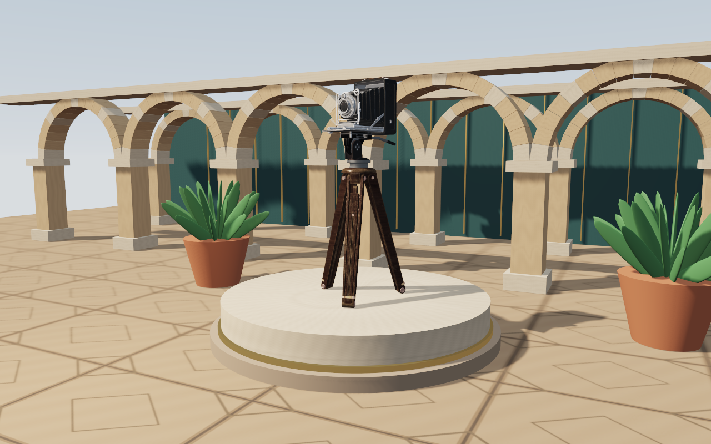

# Aperture · 仿真渲染器

一个可独立运行的 C++20 / Vulkan 1.3 离屏延迟渲染引擎。场景接口、相机和传感器输出位于 `include/sim`，Vulkan 实现在 `src`，GLFW 和 Dear ImGui 只在 `example` 中使用。开发与审核入口见 [FRAMEWORK](FRAMEWORK.md)，功能、技术、架构和进度分别维护。



## 构建与运行

Windows 参考环境为 Visual Studio 2022 x64、CMake 3.24 及以上、Vulkan SDK 1.3 及以上（包含 glslc）。设备需要支持动态渲染、至少五个颜色附件和带计算能力的图形队列。以下命令在 renderer 目录运行。首次全新构建会下载校验过的固定版本 GLM、stb、GLFW、Dear ImGui。现有 build 已配置为使用本机下载的源码。

```powershell
cmake -S . -B build -G "Visual Studio 17 2022" -A x64
cmake --build build --config Release
ctest --test-dir build -C Release --output-on-failure
.\build\Release\gallery.exe
```

- `gallery --model path/to/asset.glb` 将静态不透明 glTF 模型放到展台上，也支持含外部缓冲和图片的 .gltf。
- `gallery --capture image.png` 无窗口渲染并导出 PNG。可与 `--model` 组合。
- `gallery --benchmark` 实测 1、4、8 个视图的批次耗时。每轮预热后统计 120 个批次，包含快照、录制、提交及最后一批 GPU 完成等待。
- `gallery --smoke --validation` 创建隐藏窗口、切换场景、调整窗口尺寸，运行 12 帧后退出。`sensor_check --validation` 验证传感器数据与剔除，`pass_check --validation` 按输出通道核对实际执行的 pass 清单，`points_check --validation` 核对点云与网格的双向遮挡、强度/半径语义、相机姿态与双轴内参下的点尺寸，以及点云变化后 TAA 历史是否刷新、仅 Hdr 请求是否误推进历史基线，`observation_check --validation` 核对标定与投影一致、采样时刻、Beauty 与调试图同帧互不串色、真值通道独立于曝光与抖动、处理链无法覆盖真值。`graph_check` 不需要 GPU 设备，直接检查帧图的裁剪、依赖与诊断；`shader_check` 同样不需要设备，检查着色器目录的解析顺序与失败诊断；`package_check` 由 CTest 驱动，把当前构建安装到全新前缀、核对安装树契约（含导出 target 必须带 `cxx_std_20` 编译特性），再让一个只认 `find_package` 的外部项目构建并离屏渲染（见下节）；配置前缀只做只读检查，两个默认查找分支由测试目录内的隔离构建覆盖，脚本的全部写入与递归清理都限制在自己的测试前缀内。validation 模式需要 SDK 验证层。
- 仅编译引擎可传入 `-DRENDERER_EXAMPLE=OFF -DBUILD_TESTING=OFF`。gallery 在构建树里靠可执行文件相对路径找到着色器，示例资产仍来自源码目录；安装与外部消费见下节。
- `python tools/pngdiff.py a.png b.png` 统计两张 PNG 的差异字节数、最大与平均通道差，用于核对捕获画面是否只差舍入。

## 安装与消费

```powershell
cmake -S . -B build -G "Visual Studio 17 2022" -A x64 -DCMAKE_INSTALL_PREFIX=C:/libs/sim-renderer
cmake --build build --config Release
cmake --install build --config Release
```

安装树自包含：`include/sim` 公共头文件、`include/glm`（glm 是公共头文件里的类型，随包安装）、`lib/renderer.lib`、`share/sim/shaders/*.spv` 与 `lib/cmake/SimRenderer`。外部项目只需要：

```cmake
find_package(SimRenderer 0.1 REQUIRED)
target_link_libraries(app PRIVATE sim::renderer)
```

包配置只请求 `find_dependency(Vulkan 1.3)`——着色器已预编译为 SPIR-V，消费者不需要 glslc。导出的 target 带 `cxx_std_20` 编译特性，消费者不必自己设置 C++ 标准。着色器目录按以下顺序解析，取第一个含 `geometry.vert.spv` 的：

1. `DeviceOptions::shaderDirectory`——显式指定，设了就必须有效，否则报错；
2. 环境变量 `SIM_SHADER_DIR`——同上；
3. 可执行文件相邻的常见布局：`<exe>/shaders`、`<exe>/../share/sim/shaders`、`<exe>/../shaders`、`<exe>/share/sim/shaders`——构建树和"应用装进同一前缀"都靠它命中；
4. 编译进二进制的安装目录（配置本项目时的 `CMAKE_INSTALL_PREFIX`）。

按配置前缀安装即可直接使用；用 `cmake --install --prefix` 装到别的位置时，设置第 1 或第 2 项。`Renderer::shaderDirectory()` 返回实际使用的目录，排查问题时先看它。

## 特性清单

| 范围 | 当前实现 |
|---|---|
| 场景与资产 | 有父子关系的 Object3D、局部到世界变换、稳定实例 ID、场景快照；同一快照由共享 RenderScene 承载，多相机共用网格、材质与静态实例数据，首次资产合并为一次上传并以时间线声明提交依赖 |
| 模块与点云 | 网格与点云是并列注册的两个模块，主调度只遍历模块协议、无类型分支。点云按世界单位半径与强度绘制实例化公告板，与网格共用一张深度图双向遮挡，并写同一套 G-buffer、米制深度与实例标签 |
| 帧图 | pass 只声明读写意图，帧图负责反向裁剪、RAW/WAR/WAW 依赖、子资源与缓冲范围求交、屏障推导；跨帧历史以持久导入/导出/恢复表达。阴影、几何、光照、时序解析、颜色变换、读回是彼此独立、可按请求裁剪的 pass |
| 几何 | Box、Sphere、Cylinder、Cone、Capsule、点集 Convex、索引 TriangleMesh。各生成器输出统一 BufferGeometry |
| 材质 | GGX 金属粗糙度模型、底色/法线/金属粗糙度纹理、sRGB 解码、mipmap、线性 HDR、色调映射。环境项使用解析天空近似 |
| 光照 | 一盏方向光，最多 16 盏平方反比衰减点光。方向光采用四级 CSM、光空间 texel 对齐和 3×3 PCF |
| 剔除 | CPU 包围盒视锥剔除 |
| TAA | 静止时对 16 个 Halton 子像素样本取线性 HDR 平均，前景与天空边缘均按覆盖率积累。运动时使用无抖动速度、前景速度扩展、逐点深度检验、三次重建和邻域限幅。每个视图独立保存历史 |
| 传感器 | 按像素指定 fx/fy/cx/cy，GPU 附件访问，可选异步 RGBA8、米制 Z 和 uint32 实例 ID 批量读回，帧携带仿真时间。`observe()` 在同一次提交上另返回标定、采样时间与通道语义，投影由标定反算且与渲染器逐元素一致；处理链只能新增派生输出 |
| 呈现 | 调试通道不进入光照：`lighting.frag` 只输出 Beauty，调试图由独立的 `presentation` pass 写单独图像，因此同一帧的 Beauty 与调试视图互不串色，HDR 与时序历史里只有 Beauty |
| 导入与示例 | 静态 glTF/GLB 节点、索引、UV0、核心 PBR 贴图，外部或 GLB 内嵌 PNG/JPEG。交互展厅、七种几何体、轨道相机、光照及 G-buffer 预览（窗口采样调试图而非覆盖 Beauty） |
| 安装与分发 | `cmake --install` 产出自包含前缀：公共头文件、随包安装的 glm、静态库、预编译 SPIR-V 与 CMake 包文件；`find_package(SimRenderer)` 导出 `sim::renderer`，消费者不需要 glslc；shader 目录运行时解析，二进制不指向源码/构建目录 |

## 最小离屏采集

```cpp
#include <sim/Renderer.hpp>

sim::Renderer renderer;
sim::Scene scene;
auto material = std::make_shared<sim::MeshStandardMaterial>();
auto id = scene.add(sim::BoxGeometry(), material);
auto view = renderer.createView(640, 480);

sim::PerspectiveCamera camera;
camera.position = {0, 0, 5};
camera.fx = camera.fy = 500;
camera.cx = 320;
camera.cy = 240;

sim::RenderOptions capture;
capture.readback = true;
auto snapshot = scene.snapshot(1.25);
renderer.render(snapshot, camera, *view, capture);
auto frame = view->read();
```

这个例子中心像素的深度为 4.5 米，实例编号为 id。深度是相机坐标系中沿光轴的正距离，背景的深度和 ID 均为零。每个 View 同时容纳一个未完成提交，可在读回前先提交其他视图。read() 等待本视图并返回 CPU 自有副本；再次提交同一视图会覆盖此前的 GPU 输出。切换相机、跳转仿真或替换场景时设置 resetHistory。用 `BufferPointCloud` 加 `scene.addPoints(cloud)` 可加入点云：点的半径按世界单位给出，它与网格共用同一张深度图与实例通道，点占据的像素标签最高位为 1、低 31 位是该节点 ID。半径换算用相机纯投影的两轴焦距，俯仰或翻滚不会改变点的表观大小；点云被移动、替换、增删或改强度时，静止冻结的 TAA 历史会自动失效。

几何与贴图按资产身份缓存，材质按内容缓存，贴图还区分色彩空间。资产在构造后不可变：几何顶点、索引与包围盒、贴图像素都不能原地修改，材质按值进入快照。因此修改用户手里的材质只影响之后创建的快照，已提交的快照始终能重现当初的画面（含剔除与阴影范围），切换缓存代际后也一样。`Renderer::assetStats()` 返回场景准备、复用与上传计数，可用于确认同一快照的多台相机只准备与上传一次。

## 观测与处理链

`observe()` 与 `submit()` 是同一次提交，额外带回这一帧的标定、采样时间与通道语义。观测只读，元数据与像素始终属于同一次采样：`sampleTime.time` 必须等于快照时间，输出描述直接取自结果本身（不接受另给一份清单），标定的尺寸必须与结果一致、内参与近远平面必须有限有效。焦距与主点的真值无法从结果反推，这一项由构造观测的调用方负责——`observe()` 用的就是真实相机参数。

```cpp
sim::RenderRequest request{snapshot, camera, *view};
request.outputs = {{sim::Channel::Color, sim::Delivery::Cpu}};
request.sampleTime = sim::SampleTime{snapshot.time, 1.0 / 60};  // 曝光时长暂为元数据
auto result = renderer.observe(request);
if (result.status != sim::SubmitStatus::Submitted)
    return;  // 槽满，属于 Busy
const sim::Observation& observation = *result.observation;
const glm::mat4 p = observation.calibration().projection();       // 与渲染器逐元素一致
const auto depth = observation.read(sim::Channel::MetricDepth);   // info + bytes
const float center = reinterpret_cast<const float*>(depth.bytes.data())[0];
```

`ChannelSemantic` 给出每个通道的单位、定义、背景值以及它是否真值（不随曝光、抖动或调试呈现改变）。`observe()` 也接受 `RenderOptions::debugChannel`，但那只会产出 `Debug` 通道，不影响 `Color` 与 `Hdr`。

处理链只读观测、只写自己声明的派生输出。与任何输入通道同名、全链重名、写入未声明的名字都会被整体拒绝；阶段拿到的句柄只暴露只读描述与可写像素，改名、改尺寸、改格式在类型上不成立，因此"声明了 A 却交付成 B"没有入口：

```cpp
struct InverseDepthStage : sim::SensorStage
{
    std::string_view name() const override { return "inverse-depth"; }
    std::vector<sim::DerivedDesc> outputs(const sim::Observation& o) const override
    {
        const auto& c = o.calibration();
        return {{"inverse-depth", sim::PixelFormat::R32Float, c.width, c.height}};
    }
    void process(sim::DerivedSink& sink) const override
    {
        const auto src = sink.input().read(sim::Channel::MetricDepth);
        const auto* z = reinterpret_cast<const float*>(src.bytes.data());
        auto dst = sink.write("inverse-depth");  // 未声明就抛错；返回的是只读描述 + 可写像素
        auto out = dst.bytes();
        for (size_t i = 0; i < out.size() / sizeof(float); ++i)
            out[i] = z[i] > 0 ? 1.0f / z[i] : 0.0f;
    }
};

sim::ProcessingChain chain{"sensor"};
chain.add(std::make_unique<InverseDepthStage>());
auto processed = chain.run(result.observation);  // 源观测仍可读，派生输出另存
```

## GPU 数据契约

`View::imageView(Channel)` 暴露由视图持有的 VkImageView。附件在 render 提交完成后可按 SHADER_READ_ONLY_OPTIMAL 读取。外部消费者应使用相同设备，协调提交与资源生命周期。当前 Renderer 的录制、提交和缓存接口按单线程调用设计；场景快照可由调用方在仿真步边界生成后移交给渲染线程。仅由 GPU 消费时可打开 stableGeometry，获得像素中心的几何通道。TAA 与几何真值同时启用时，为保证采样位置会额外录制一次无抖动的几何 pass。`View::activePasses()` 返回上一帧实际执行的 pass 名，可用来确认裁剪结果；`View::stationary()` 返回上一帧是否判为静止（相机、光照与所有模块输入都与上一帧相同），可据此判断渐进细化是否收敛；它只在真正写入颜色历史的帧上为真——几何真值请求、以及时序解析被裁掉的仅 Hdr 请求都不推进历史槽与各模块的历史基线。

窗口要显示调试图时采样 `View::debugView()`，不要指望调试图出现在 `colorView()` 里：调试呈现是独立的 `presentation` pass，它写自己的图像，并把该 pass 声明为副作用根（只要请求了调试通道，这一帧就必定产出调试图）。`debugView()` 在未请求调试通道的帧上返回空句柄。此外，只要选了调试通道就必须有光照结果——`presentation` 的 HDR 描述符是静态使用的，级联视图还要读它的内容——所以"只请求几何真值 + 调试通道"的帧也会跑一次光照，但不建显示图与历史槽，也不做时序解析与颜色变换。

| 通道 | 格式与语义 |
|---|---|
| Color | RGBA8 UNORM，字节值已转 sRGB。始终是 Beauty，调试通道不会写进这里 |
| AlbedoMetal | RGBA8 UNORM，线性底色 RGB 和金属度 A |
| NormalRough | RGBA16F，世界法线 XYZ 和粗糙度 W |
| Motion | RGBA16F，XY 为上一帧 UV 减当前 UV，两个位置均在无抖动投影下计算。Z 为上一帧相机深度，W 标记存在匹配的旧实例 |
| MetricDepth / InstanceId | R32F 米制光轴深度 / R32_UINT 稳定标签。整数纹理使用最近点采样。点云占用标签最高位，低 31 位是点云节点 ID |
| HardwareDepth / Hdr | D32F 硬件深度，范围 [0,1] / RGBA16F 光照结果。Hdr 是光照输出，未经 TAA |
| Resolved | RGBA16F，时序解析后的线性颜色（TAA 之后的辐亮度，未经曝光与色调映射）。A 分量是该帧的米制深度，不表示透明度；需要线性图像的传感器应取这个通道 |
| Debug | RGBA8 UNORM，调试呈现图。内容由 `RenderOptions::debugChannel` 决定（1 法线、2 对数归一化深度、3 实例标签哈希色、4 级联分区），背景为零。请求它必须同时指定调试通道 |

## 当前边界

主要验证范围为 Windows、NVIDIA RTX 3080 Ti 和不透明静态三角网格，支持实例运动。图像畸变、按曝光时间积分的运动模糊、透明材质、骨骼动画、HDRI 预滤波 IBL、DLSS 和多 GPU 尚待扩展。TAA 负责抗锯齿。glTF 导入器读取静态姿态和上述核心材质子集，贴图使用 UV0 和重复采样；暂未覆盖完整的 glTF 材质扩展与采样器语义。帧图目前单队列顺序执行、屏障偏保守、瞬时资源按描述缓存但不做显存别名，多队列与别名复用留待后续按实测优化。点云不在 CPU 侧剔除、不投射阴影，也没有逐点速度（运动向量写零，只保证运动分支不复用旧像素，静止冻结另靠每视图的点云身份基线失效）；大规模点云按节点整体驻留一份存储缓冲，受设备的 `maxStorageBufferRange` 限制，上传批的暂存副本尚未主动回收，示例展厅也尚未加入点云。

传感器侧同样有明确边界：`SampleTime::duration` 目前只是元数据，渲染器按瞬时采样出图，曝光积分与卷帘快门留给 F12；`SensorCalibration` 只描述针孔投影与近远平面，没有畸变系数与噪声模型；处理链是 CPU 侧按通道字节工作的协议，尚未接入 GPU pass，因此大分辨率下会多一次通道拷贝。`Resolved` 与 `Hdr` 的 alpha 语义不同（前者是米制深度，后者是覆盖率），需要区分时请按通道语义表判断，不要假定两者同义。

材质、贴图及网格在构造后即不可变，修改内容需以新对象重新发布；快照按值保存材质并持有几何与贴图的固定版本，所以旧快照不受后续修改影响。首次出现的资产在一次上传批内提交，帧提交等待该批的时间线值，不随相机数量增加重复上传；准备录制仍在调用线程完成。上传批完成后在正常准备路径回收，暂存副本随之释放，`assetStats()` 的 pendingUploads 与 stagingBytes 可观察该状态。切换大型场景后可用 clearAssetCache() 切换缓存代际，旧代际的缓冲仍被在途提交或视图引用时不会销毁，最后一个引用消失后才回收。后续可以从异步准备、上传限流、显存子分配和跨视图命令录制入手优化。

示例模型的作者、许可和标志说明见 [资产来源](example/assets/ATTRIBUTION.md)。
